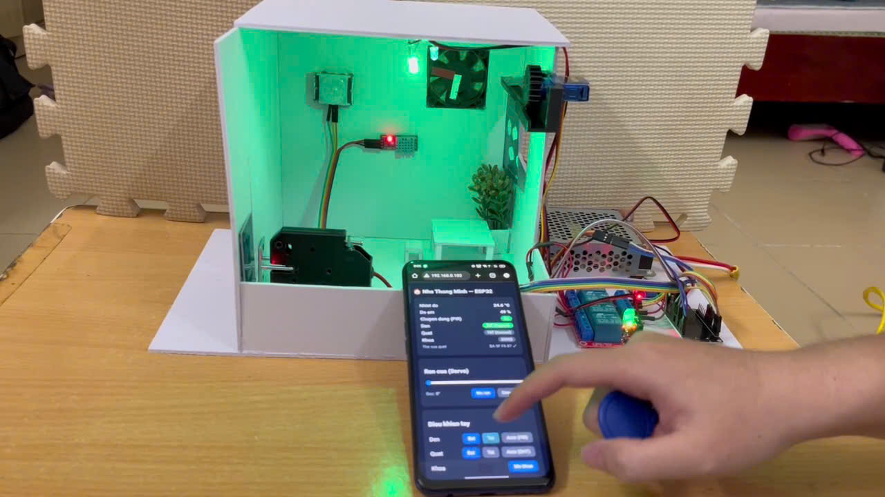
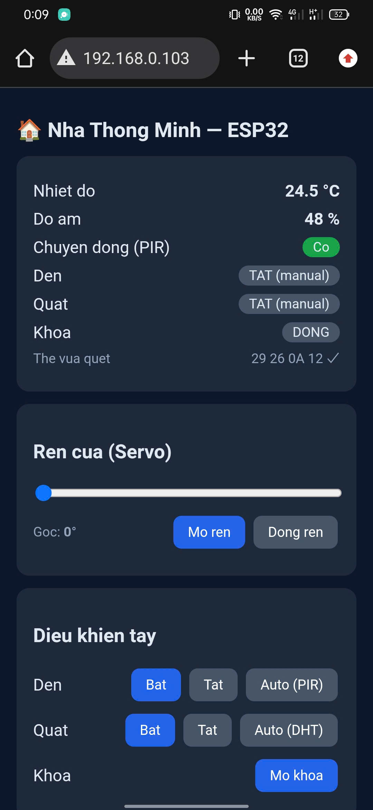
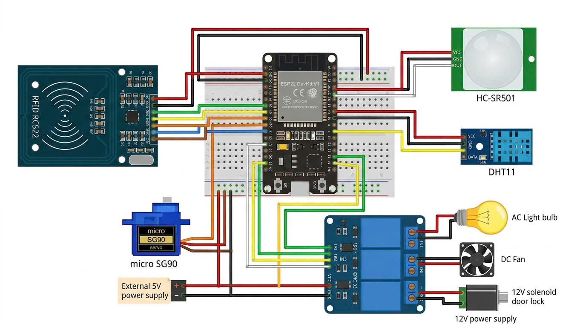

# 🏠 Nhà Thông Minh — ESP32

Mô hình **nhà thông minh** chạy trên **ESP32 DevKit** (framework Arduino / PlatformIO), tích hợp
RFID mở khóa, cảm biến chuyển động, cảm biến nhiệt độ – độ ẩm, servo kéo rèm và relay 3 kênh.
Toàn bộ điều khiển qua **giao diện Web** (HTTP + WebSocket realtime) ngay trên trình duyệt điện thoại,
hỗ trợ **cấu hình Wi-Fi**, **nạp firmware OTA** và **quản lý thẻ RFID** trực tiếp trên web.

| Mô hình thực tế | Giao diện Web |
|:---:|:---:|
|  |  |

---

## ✨ Tính năng

- 🔑 **RFID (RC522)** — quẹt thẻ hợp lệ để mở khóa cửa (relay kênh 3, tự đóng lại sau 1 giây).
- 🚶 **PIR (HC-SR501)** — tự động bật đèn khi có chuyển động, tắt sau khi hết chuyển động 15 giây.
- 🌡️ **DHT11** — tự động bật/tắt quạt theo nhiệt độ (có hysteresis chống rung relay).
- 🪟 **Servo SG90** — mở/đóng rèm theo góc 0–180° điều khiển từ web.
- 💡 **Relay 3 kênh** — Đèn / Quạt / Khóa, có chế độ **Tự động** (theo cảm biến) hoặc **Thủ công** (từ web).
- 🌐 **Web App realtime** — xem trạng thái và điều khiển qua WebSocket, không cần cài app.
- 📶 **Cấu hình Wi-Fi tại chỗ** — lưu vào NVS; không kết nối được thì tự phát Wi-Fi riêng (AP) để cấu hình lại.
- ⬆️ **OTA** — nạp firmware mới qua trình duyệt, không cần cắm dây.
- 🪪 **Quản lý thẻ RFID trên web** — thêm/xóa thẻ không cần nạp lại firmware (lưu trong NVS).

---

## 🔌 Sơ đồ đấu nối



### Bảng chân (PINOUT — ESP32 DevKit)

| Module | Chân module | Chân ESP32 | Ghi chú |
|---|---|---|---|
| **RFID RC522** (SPI) | SDA (SS) | GPIO **5** | VCC = **3V3** (⚠️ không cấp 5V) |
| | SCK | GPIO **18** | |
| | MOSI | GPIO **23** | |
| | MISO | GPIO **19** | |
| | RST | GPIO **22** | Có thể ghim 3V3 thay vì nối GPIO (xem ghi chú) |
| **PIR HC-SR501** | OUT | GPIO **27** | Digital input |
| **DHT11** | DATA | GPIO **4** | Pull-up 4.7k–10k nếu cần |
| **Servo SG90** | Signal (PWM) | GPIO **13** | Cấp **nguồn 5V ngoài**, chung GND |
| **Relay IN1 — Đèn** | IN1 | GPIO **26** | |
| **Relay IN2 — Quạt** | IN2 | GPIO **25** | |
| **Relay IN3 — Khóa** | IN3 | GPIO **33** | Khóa solenoid 12V cấp nguồn riêng |

> **Nguồn:** ESP32 và logic dùng 3.3V/5V; servo cấp 5V ngoài; khóa solenoid cấp 12V. **Tất cả phải chung GND.**

---

## 🧰 Phần cứng & Thư viện

**Phần cứng:** ESP32 DevKit V1 · RC522 · HC-SR501 · DHT11 · SG90 · Relay 3 kênh · bóng đèn AC · quạt DC · khóa solenoid 12V.

**Thư viện** (`platformio.ini`):

- `miguelbalboa/MFRC522` — đọc thẻ RFID
- `adafruit/DHT sensor library` + `Adafruit Unified Sensor` — DHT11
- `madhephaestus/ESP32Servo` — servo
- `links2004/WebSockets` — WebSocket realtime
- `bblanchon/ArduinoJson` — đóng/giải mã JSON

---

## 🚀 Build & nạp

Cần cài [PlatformIO](https://platformio.org/) (CLI hoặc extension VS Code).

```bash
# Biên dịch
pio run

# Nạp qua cổng USB
pio run -t upload

# Mở Serial Monitor (115200 baud)
pio device monitor
```

### Cấu hình trước khi nạp

Mở `include/config.h` và chỉnh:

- `WIFI_SSID`, `WIFI_PASSWORD` — Wi-Fi nhà bạn.
- `AUTHORIZED_UIDS[]` — danh sách UID thẻ RFID **cố định** (tùy chọn; có thể thêm thẻ sau qua web).
- Các ngưỡng: `TEMP_FAN_ON` / `TEMP_FAN_OFF`, `LIGHT_HOLD_MS`, `LOCK_OPEN_MS`...
- `RELAY_ACTIVE_LOW` — đổi `true`/`false` cho đúng kiểu kích của module relay bạn dùng.

---

## 📱 Sử dụng giao diện Web

Sau khi nạp, mở Serial Monitor để xem IP của ESP32 rồi truy cập `http://<IP-ESP32>/`.

- **`/`** — Trang điều khiển: xem nhiệt độ, độ ẩm, chuyển động, trạng thái đèn/quạt/khóa, thẻ vừa quét; điều khiển rèm (servo), bật/tắt đèn & quạt (thủ công hoặc trả về Auto), mở khóa từ xa.
- **`/settings`** — Cấu hình **Wi-Fi** (lưu vào NVS, tự khởi động lại) và **nạp firmware OTA**.
- **`/rfid`** — **Quản lý thẻ RFID** (xem bên dưới).

### Chế độ AP dự phòng

Nếu ESP32 không kết nối được Wi-Fi đã lưu, nó tự phát một mạng Wi-Fi riêng:

- SSID: **`SmartHome-ESP32`** · Mật khẩu: **`12345678`**
- Kết nối vào mạng này rồi mở `http://192.168.4.1/` để vào trang cấu hình.

---

## 🪪 Quản lý thẻ RFID trên Web

Vào **`http://<IP-ESP32>/rfid`** (hoặc bấm link 🔑 trên trang chính):

1. **Quẹt thẻ** vào đầu đọc RC522 — UID hiện ngay (realtime), kèm trạng thái `✓ (đã có)` / `✗ (chưa có)`.
2. Bấm **"Dùng UID này để thêm"** để tự điền, đặt **tên gợi nhớ** rồi **Thêm thẻ**.
3. Thẻ được lưu vào **NVS** → không mất khi tắt nguồn, **không cần nạp lại firmware**.
4. Mỗi thẻ có nút **Xóa**. Thẻ khai báo trong `config.h` hiển thị nhãn **"cố định"** và không xóa được qua web.

> UID nhập tay được tự chuẩn hóa (chấp nhận `A1B2C3D4`, `a1:b2:c3:d4`, `A1 B2 C3 D4`…). Tối đa 30 thẻ dynamic.

---

## 📂 Cấu trúc dự án

```
Smart_Home/
├── src/main.cpp          # Toàn bộ firmware (sensors, relay, web, websocket, RFID)
├── include/config.h      # Cấu hình chân, Wi-Fi, ngưỡng, danh sách UID cố định
├── img/                  # Ảnh mô hình, sơ đồ, giao diện
├── platformio.ini        # Cấu hình board & thư viện
└── README.md
```

---

## 📜 Giấy phép

Dự án học tập / cá nhân. Bạn có thể tự do dùng lại và chỉnh sửa.
